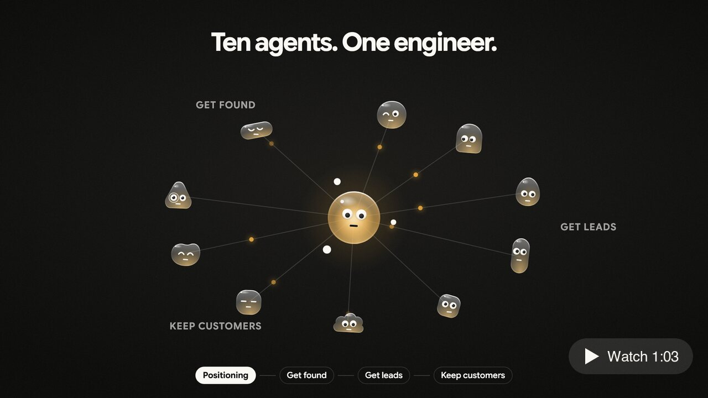

# 你好，我是 Amber 👋

[English](README.md) · **中文**

我是一名 AI 营销工程师，住在新西兰奥克兰。我一个人负责一家 AI 创业公司的整个市场职能，靠的是自己搭建的 agent 系统。在 [flowai.co.nz](https://www.flowai.co.nz)，团队可以签合同请我和他们一起搭这套系统；我也在看高级营销工程师和 GTM 工程师的职位机会。搭建笔记：[用 Claude Code 跑整个市场部](https://www.flowai.co.nz/blog/running-marketing-on-claude-code)（英文）。系统都在这里公开。说到的，都有凭证。

[flowai.co.nz](https://www.flowai.co.nz) · [LinkedIn](https://www.linkedin.com/in/amberlan/) · [邮箱](mailto:amber.lan.growth.digital@gmail.com)

---

## 一分钟了解这套系统

一段一分钟的无声短片，讲清整个系统：先定位，再由十个智能体负责被找到、获取线索和留住客户，每一次发送都由人来批准。[在 flowai.co.nz 观看](https://www.flowai.co.nz/zh/sprints/#film)

---

## 最新文章

面向新西兰和澳大利亚中小企业的 AI 搜索、AI 营销与营销成本指南（英文）。全部文章：[flowai.co.nz/blog](https://www.flowai.co.nz/blog/) · 术语表：[flowai.co.nz/glossary](https://www.flowai.co.nz/glossary/)

<!-- BLOG-POST-LIST:START -->- [How do you build a live marketing report with Claude Code?](https://www.flowai.co.nz/blog/live-marketing-report-claude-code) 
- [n8n, Zapier, Make or Claude Code: which automation tool suits a small business?](https://www.flowai.co.nz/blog/n8n-vs-zapier-vs-make-vs-claude-code) 
- [How to hire an AI agent developer: questions to ask, red flags and what you should own.](https://www.flowai.co.nz/blog/how-to-hire-an-ai-agent-developer) 
- [Claude for business or ChatGPT Business: what does each cost a New Zealand team in 2026?](https://www.flowai.co.nz/blog/claude-vs-chatgpt-business-cost-nz) 
- [Claude Code for marketing agencies: what to build first, and how to keep it safe.](https://www.flowai.co.nz/blog/claude-code-for-marketing-agencies) 
<!-- BLOG-POST-LIST:END -->

---

## 新项目：Outreach

描述你的产品，它帮你找到匹配的人，并说明每个人为什么匹配。

[**Outreach**](https://github.com/Amberlanqinyun/Outreach) - 开源 AI 找客工具。在线版：[openoutreach.app](https://openoutreach.app)

---

## 精选项目

今天真正在跑营销的那几个。

[**geo-seo-claude**](https://github.com/Amberlanqinyun/geo-seo-claude) - 面向 Claude Code 的 GEO/AEO 工具包：可引用度评分、AI 爬虫分析、结构化数据、PDF 报告。让品牌被 ChatGPT、Claude 和 Perplexity 引用

[**claude-ads**](https://github.com/Amberlanqinyun/claude-ads) - Claude Code 的付费投放运营技能，覆盖 12 个广告平台：有据可查的审计、确定性评分、版本化报告

[**flowainz**](https://github.com/Amberlanqinyun/flowainz) - 面向新西兰服务型企业的自动化、AI 搜索友好的 SEO 内容。输入一份 brief，输出可直接发布的页面

---

## 搜索与 AI 可见度

让品牌被搜索引擎和 AI 答案引擎找到。

[**geo-seo-claude**](https://github.com/Amberlanqinyun/geo-seo-claude) - Claude Code 的 GEO/AEO 工具包

[**flowainz**](https://github.com/Amberlanqinyun/flowainz) - AI 搜索友好的 SEO 内容，从 brief 到成品页面

[**AI 可见度基准测试**](https://www.flowai.co.nz/tools/benchmark) - 两分钟看清你的业务在 AI 搜索里有多可见。无需留邮箱

---

## 内容与获客

会写、会发、会找对人的系统。

[**social-media-os**](https://github.com/Amberlanqinyun/social-media-os) - 规划一次，按时发出各平台原生版本

[**Outreach**](https://github.com/Amberlanqinyun/Outreach) - 开源 AI 找客工具

[**finding-users-on-reddit-using-ai**](https://github.com/Amberlanqinyun/finding-users-on-reddit-using-ai) - 找到 Reddit 上正在描述你所解决问题的人，并按意图分级

[**claude-ads**](https://github.com/Amberlanqinyun/claude-ads) - 在 Claude Code 里审计和调整 12 个广告平台的投放

---

## 应用

因为想要它们存在，所以做了出来。

[**flowaistudio**](https://github.com/Amberlanqinyun/flowaistudio) - reMarkable 墨水屏平板的目标型计划与日记模板

[**mind-traveller-storybook**](https://github.com/Amberlanqinyun/mind-traveller-storybook) - 选一个国家，获得一套精选的四周文化体验计划

[**latticework**](https://github.com/Amberlanqinyun/latticework) - 查理·芒格思维模型 iOS 应用：每日智慧、回忆练习、决策日志

[**Unhook**](https://github.com/Amberlanqinyun/Unhook) - 连接新西兰心理健康危机与支持服务

[**onedayatatime**](https://github.com/Amberlanqinyun/onedayatatime) - 艰难时刻的温和小应用：停一下，呼吸，迈出一小步
